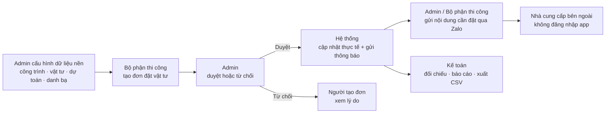

# Quản lý đặt vật tư công trình

Ứng dụng Expo mobile + Express API cho nội bộ công ty: Bộ phận thi công tạo nhu cầu vật tư, Admin duyệt và quản lý dữ liệu, Kế toán theo dõi chi phí/dự toán/thực tế. Nhà cung cấp là bên thứ ba, không đăng nhập app; hệ thống chỉ lưu thông tin liên hệ/Zalo để gửi nội dung cần đặt.


## Tech stack

- **Expo / React Native** cho app mobile
- **Next.js + shadcn/ui** trong `/web` cho bản web đầy đủ chức năng
- **Node.js + Express** trong `/server` cho REST API
- **PostgreSQL + Drizzle ORM** cho schema/query
- **Better Auth** cho xác thực
- **Resend** cho email mời người và email thông báo
- Giao diện tiếng Việt, tiền tệ VND

## Vai trò

| Role       | Chức năng chính                                                       |
| ---------- | -------------------------------------------------------------------- |
| `admin`    | Quản lý công trình, vật tư, dự toán, đơn vị cung cấp, thành viên; duyệt/từ chối đơn; xem toàn bộ |
| `site`     | Bộ phận thi công: tạo đơn vật tư, theo dõi đơn của mình, xem tổng hợp công trình |
| `accountant` | Kế toán: xem đơn, tổng hợp công trình, đối chiếu, thống kê chi phí và xuất CSV |
| `supplier` | Role dữ liệu cũ, không dùng để đăng nhập app nội bộ |
| `director` | Role cũ, được migrate/gộp về `admin` |

## Yêu cầu

- Node.js ≥ 20 (khuyến nghị 22)
- pnpm ≥ 10
- Một PostgreSQL database

## 1. Cấu hình môi trường

Sao chép file mẫu và điền giá trị thật:

```bash
cp .env.example .env
```

| Biến                  | Mô tả                                               |
| --------------------- | --------------------------------------------------- |
| `DATABASE_URL`        | Chuỗi kết nối PostgreSQL                             |
| `BETTER_AUTH_SECRET`  | Chuỗi ngẫu nhiên: `openssl rand -hex 32`            |
| `BETTER_AUTH_URL`     | URL backend auth                                    |
| `BETTER_AUTH_ALLOWED_HOSTS` | Allowlist hostname API và web cho callback OAuth đa domain |
| `CORS_ORIGINS`        | Danh sách origin web/mobile dev được phép           |
| `EXPO_PUBLIC_API_URL` | URL API public cho app Expo                         |
| `RESEND_API_KEY`      | API key Resend để gửi email thông báo               |
| `RESEND_FROM_EMAIL`   | Email người gửi Resend                              |
| `APP_URL`             | Link app/backend dùng trong email mời người         |

> Không hardcode secret trong code — tất cả đọc từ `.env`.

## Luồng nghiệp vụ



1. Admin cấu hình công trình, vật tư, dự toán, danh bạ đơn vị cung cấp và mời nhân sự nội bộ.
2. Bộ phận thi công tạo đơn đặt vật tư theo công trình.
3. Admin duyệt hoặc từ chối đơn.
4. Khi duyệt, hệ thống cập nhật bảng thực tế của công trình và gửi email/in-app notification.
5. Admin hoặc Bộ phận thi công gửi nội dung cần đặt qua Zalo cho đơn vị cung cấp. Nội dung chỉ gồm mã đơn, công trình, vật tư, số lượng và đơn vị tính.
6. Kế toán xem tổng hợp công trình, đối chiếu dự toán/thực tế, thống kê chi phí và xuất CSV.

## Cài đặt & kiểm tra

```bash
pnpm install
pnpm typecheck
pnpm --dir server typecheck
pnpm exec expo export --platform android --clear
```

## 3. Chạy dev

```bash
pnpm dev
```

Mở Expo app/web preview → đăng nhập bằng tài khoản nội bộ đã được Admin mời/cấp quyền.

Để chạy bản web Next.js song song với mobile, mở terminal khác và chạy `pnpm web` (mặc định `http://localhost:3000`). Xem [hướng dẫn web](./web/README.md) để cấu hình API và triển khai.

Seed quản trị mặc định chỉ đảm bảo `nttantts@gmail.com` có quyền Admin và không tạo tài khoản demo:

```bash
pnpm db:seed
```

Nếu tài khoản chưa tồn tại, có thể đặt mật khẩu tạm bằng `SEED_ADMIN_PASSWORD`; nếu không, script sẽ sinh mật khẩu tạm và in ra terminal.

## Scripts

| Lệnh               | Tác dụng                                   |
| ------------------ | ------------------------------------------ |
| `pnpm start`       | Chạy Expo dev server                       |
| `pnpm typecheck`   | Typecheck app                              |
| `pnpm --dir server typecheck` | Typecheck backend              |
| `pnpm exec expo export --platform android --clear` | Kiểm tra export Android |

## Cấu trúc chính

```
app/                      # Expo Router screens
mobile/                   # component, API client, theme
server/                   # Express REST API + Better Auth + Drizzle schema
drizzle/                  # SQL migrations tham chiếu
docs/                     # hướng dẫn và sơ đồ minh họa
```

## Ghi chú thiết kế

- **Auto phân bổ**: khi Admin duyệt đơn, trong 1 transaction số lượng/tiền của
  từng dòng được cộng dồn vào bảng `project_material_actual` (bảng tổng hợp thực tế).
- **Nhà cung cấp** không có tài khoản app; chỉ nhận nội dung cần đặt qua Zalo.
- **Email**: Resend được dùng cho mời người và thông báo đơn; nếu thiếu API key thì app vẫn hoạt động và chỉ bỏ qua email.
