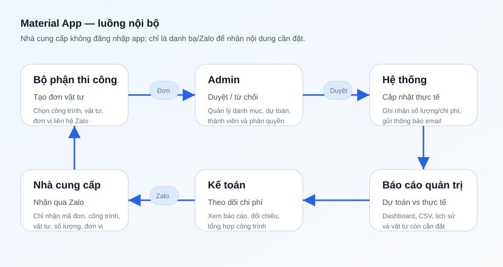
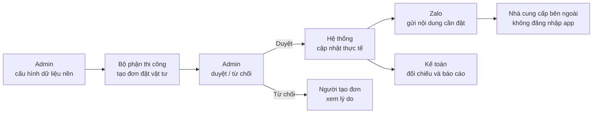

# Hướng dẫn sử dụng Material App



## Vai trò

| Vai trò | Quyền chính |
| --- | --- |
| Admin | Quản lý công trình, vật tư, dự toán, đơn vị cung cấp, thành viên; duyệt/từ chối đơn; xem báo cáo và nhật ký. |
| Bộ phận thi công | Tạo đơn vật tư, theo dõi đơn của mình, xem tổng hợp công trình và đối chiếu. |
| Kế toán | Xem đơn, tổng hợp công trình, đối chiếu dự toán/thực tế, thống kê chi phí và xuất CSV. |
| Nhà cung cấp | Không đăng nhập app. Chỉ là danh bạ liên hệ/Zalo để nhận nội dung cần đặt. |

## Luồng nghiệp vụ



1. Admin cấu hình công trình, vật tư, dự toán và danh bạ đơn vị cung cấp.
2. Admin mời nhân sự nội bộ ở màn hình **Menu → Thành viên**. Hệ thống gửi email bằng Resend nếu đã cấu hình `RESEND_API_KEY`.
3. Bộ phận thi công tạo đơn vật tư, chọn công trình và đơn vị cung cấp liên quan.
4. Admin duyệt hoặc từ chối đơn.
5. Khi đơn được duyệt, hệ thống cập nhật thực tế của công trình và gửi thông báo email/in-app.
6. Admin hoặc Bộ phận thi công gửi nội dung cần đặt qua Zalo cho đơn vị cung cấp. Nội dung Zalo không chứa giá, ngân sách, ghi chú nội bộ hay công nợ.
7. Kế toán xem đối chiếu, thống kê chi phí và xuất CSV khi cần.

## Cấu hình email Resend

Thêm các biến sau vào môi trường backend Dokploy:

```env
RESEND_API_KEY="re_xxx"
RESEND_FROM_EMAIL="Material App <no-reply@your-domain.com>"
APP_URL="https://domain-hoac-link-app-cua-ban"
```

Nếu chưa cấu hình `RESEND_API_KEY`, tính năng mời người vẫn tạo tài khoản và hiển thị mật khẩu tạm để Admin gửi thủ công.

## Seed tài khoản quản trị

Không còn tài khoản demo trong seed. Lệnh sau chỉ đảm bảo `nttantts@gmail.com` có quyền Admin, không xoá dữ liệu hiện có:

```bash
pnpm db:seed
```

Nếu tài khoản chưa tồn tại, đặt `SEED_ADMIN_PASSWORD` trước khi chạy để dùng mật khẩu tạm cố định; nếu không đặt, script sẽ sinh mật khẩu tạm và in ra terminal.
